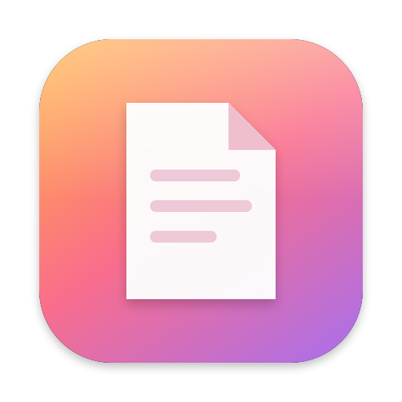
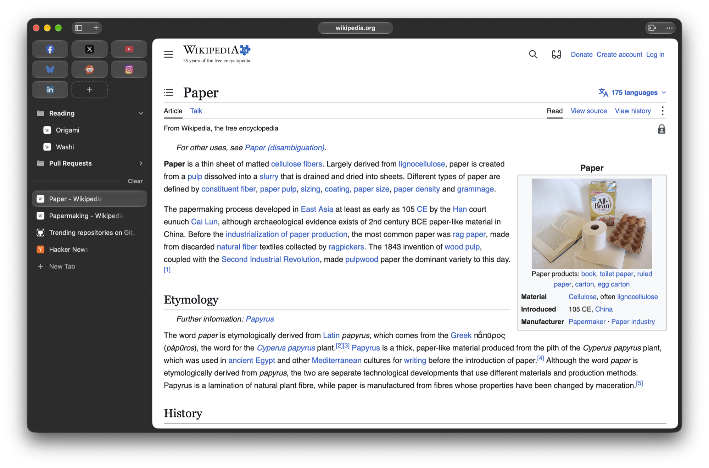
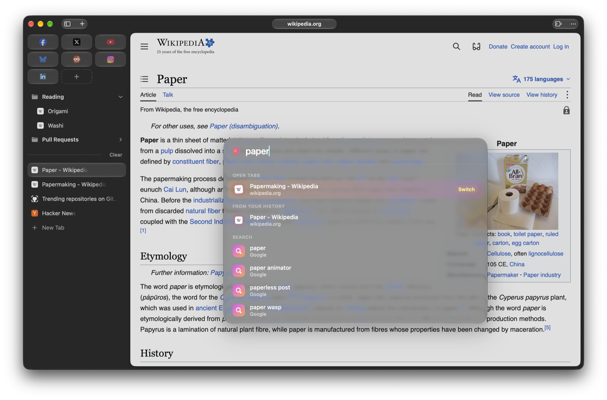

<p align="center">
  
</p>

<h1 align="center">Paper</h1>

<p align="center">
  A calm, liquid-glass browser for macOS with almost no chrome.<br>
  A sidebar for your places, a launcher for everything else, and the web in between.
</p>

<p align="center">
  
</p>

## What it is

Paper strips the browser down to three small glass pills and a sidebar:

- **Left pill:** toggle the sidebar and open a new tab.
- **Centre pill:** the bare domain you're on (`reddit.com`, not the whole URL). Click it to edit the address.
- **Right pill:** extensions and the menu.

Everything else lives in the **sidebar**. **Essentials** sit at the top, your **bookmark folders** under them, then your **tabs** below a divider with a **Clear** button. The sidebar pushes the page aside rather than covering it. Hide it, and it peeks out when you nudge the pointer against the left edge.

There's no address bar. **⌘T** opens a launcher in the middle of the page that searches your open tabs, your history and the web at once.

<p align="center">
  
</p>

Paper comes in two builds that share one design:

| | Engine | Status |
|---|---|---|
| **[Paper for WebKit](#paper-for-webkit-try-it-now)** (`prototype/`) | WKWebView + SwiftUI | **Works today.** Builds in seconds. |
| **[Paper for Chromium](#paper-for-chromium)** (`overlay/`, `patches/`) | A Chromium 156 fork | Written, not yet compiled. See [status](#status). |

## Features

**Sidebar**
- **Essentials:** your always-there sites in a grid of glass tiles. They get more columns as the sidebar widens.
  - An open Essential gets a dot, and the active one glows with a blurred wash of its own favicon.
  - Drag to reorder (the others spring out of the way), drag one out to turn it back into a tab, or drag a tab in.
  - Clicking the active Essential after you've wandered off takes you back to its home page.
- **Bookmark folders:** nested and collapsible. Drop a tab or bookmark onto a folder to file it, and rename or delete from the right-click menu.
- **Clear:**
  - One click closes every tab except the one you're on.
  - The button then wobbles to show it's armed. A second click closes that tab too.
  - Essentials are never cleared.
- **Resizable:** drag the edge between 200 and 420pt. It snaps to the default width; double-click the edge to reset.
- **Hover to peek:** with the sidebar hidden, push the pointer to the left edge and it slides out over the page.

**Launcher**
- One box for URLs, open tabs, history and Google suggestions, with tabs ranked first.
- It opens centred on the page. ⌘T opens a new tab, ⌘L (or clicking the domain) edits the current one.
- A window with no tabs is just the launcher, and it stays until you go somewhere.

**Feel**
- macOS Liquid Glass throughout (`glassEffect`), on a translucent window.
- **Trackpad haptics:** a tick when you pick something up, a snap as it crosses each slot, and a bump when you drop it, enter a folder, Clear, or swipe past the threshold.
- **Swipe to go back and forward**, with a glass chevron that fills once a release will navigate. The page keeps priority: carousels and wide content still scroll sideways.
- **Automatic picture in picture:** a playing video floats out when you switch tabs or apps, and docks back when you return. It works on YouTube, and ignores muted hover previews.

## Paper for WebKit (try it now)

Requires macOS 26 (Tahoe) or later and Xcode 26+ (or the Swift 6 toolchain).

```sh
git clone https://github.com/genericmilk/paper.git
cd paper/prototype
./scripts/build-app.sh      # release build → dist/Paper.app, with icon, ad-hoc signed
open dist/Paper.app
```

During development, `./run.sh` does a fast debug build and relaunches the app.

The app is signed only for your own Mac. If macOS blocks a copy you've moved to another Mac, right-click it and choose **Open** once.

State (tabs, Essentials, bookmarks, history, sidebar width) lives in `~/Library/Application Support/PaperPrototype/state.json`. Set `PAPER_STATE_DIR` to run a second copy with separate state.

### Shortcuts

| Keys | Action |
|---|---|
| ⌘T | New tab (launcher) |
| ⌘L | Edit current address |
| ⌘W | Close tab |
| ⌘S | Toggle sidebar |
| ⌘R | Reload |
| ⌘[ / ⌘] | Back / forward |
| ⌘1 … ⌘9 | Open Essential 1 to 9 |
| ⌥⌘P | Picture in picture |
| Two-finger swipe → / ← | Back / forward |

### Known limits

- **No Chrome extensions.** The extensions button explains this; it's what the Chromium build is for.
- **Not a default browser yet.** It doesn't handle links opened from other apps.
- **Picture in picture uses a WebKit preference that isn't public API** (`allowsPictureInPictureMediaPlayback`, the one Safari uses). It's guarded so it does nothing if a future macOS removes it.
- **Favicons** come from Google's favicon service.

## Paper for Chromium

The same design as a real Chromium fork, so Paper can run Chrome extensions and Chromium's engine. It's maintained the way Helium and ungoogled-chromium are: a pinned Chromium tag, plus new source files, plus a small ordered patch series.

- **Top bar:** Chromium 156's own macOS 26 glass frame is switched on. The tab strip is removed, and the stock toolbar is relaid out as the three pills. The real extension and app-menu buttons stay put, so their popups anchor normally.
- **Sidebar and launcher:** top-chrome WebUI pages (the same machinery as Tab Search) with transparent backgrounds over the glass.
  - The launcher is driven by Chromium's real omnibox ranking (`AutocompleteController`).
  - Essentials are pinned tabs, created when you first click one.
- **Haptics:** `NSHapticFeedbackManager`, reached from the WebUI over mojo.

| Patch | What it does |
|---|---|
| `0001-branding` | Product name Paper, bundle id `app.paper.browser` |
| `0002-glass-frame-by-default` | Turns on Chromium's macOS 26 glass window frame (`kGlassFrame`) |
| `0003-build-wiring` | Compiles Paper into `//chrome/browser/ui`, packs its WebUI resources, registers the WebUI names |
| `0004-webui-and-prefs-registration` | The two WebUIs, their mojo binders, and the `paper.*` prefs |
| `0005-sidebar-column` | No tab strip, plus a sidebar column below the top bar that pushes the page |
| `0006-toolbar-becomes-top-bar` | Paper's three-pill layout inside the stock toolbar |
| `0007-launcher-commands` | ⌘T and ⌘L open the launcher |

Every patched file includes only `paper_hooks.h`. Moving to a new Chromium milestone means re-placing a few hook lines, not merging features. All 7 patches apply cleanly to 156.0.8078.48 (17 files, about 90 lines).

**Building it** needs about 110–130 GB free (an external SSD is fine; set `CHROMIUM_DIR`), and a first build takes several hours:

```sh
scripts/bootstrap.sh   # depot_tools + a history-less checkout at CHROMIUM_VERSION
scripts/apply.sh       # copy overlay/ into the tree, apply patches/
scripts/build.sh       # gn gen + autoninja (JOBS=6 to limit memory use)
scripts/run.sh         # launch out/Paper/Paper.app with a throwaway profile
```

To develop, edit in the Chromium tree, then run `scripts/export-patches.sh <patch-name> <files…>`. It writes the patch and copies new files back into `overlay/`. Running with `--disable-features=PaperUi` gives stock Chromium for comparison.

## Repository layout

```
prototype/            Paper for WebKit (SwiftUI + WKWebView)
  Sources/Paper/        the app
  scripts/              build-app.sh, icon generator
  run.sh                debug build and relaunch
overlay/              Paper for Chromium: new files copied into the Chromium tree
  chrome/browser/ui/views/paper/      native chrome (C++ Views)
  chrome/browser/ui/webui/paper/      sidebar and launcher WebUI controllers, mojom
  chrome/browser/resources/paper/     sidebar and launcher front end (TypeScript, Lit, CSS)
patches/              hook lines in existing Chromium files
scripts/              bootstrap / apply / build / run / export-patches for Chromium
CHROMIUM_VERSION      the pinned Chromium tag
args.gn               GN build arguments
```

## Status

- **WebKit build:** usable day to day. It's where the design is being worked out.
- **Chromium build:** every Chromium API, signature and hook point was checked against the 156 sources, and the patches apply. It **has not been compiled yet**, so expect a round of small fixes on the first build.

Next up:
- [ ] First Chromium build and `gn check`
- [ ] Default-browser support (handling links from other apps)
- [ ] Localised strings
- [ ] Tests for Clear and Essentials persistence

## License

BSD 3-Clause; see [LICENSE](LICENSE). The Chromium patches modify Chromium, which is © The Chromium Authors under its own BSD-style license.
